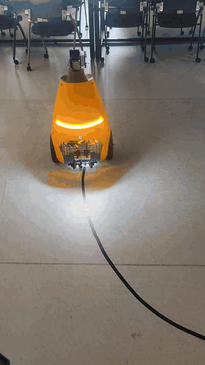

# ROLEy · 乐易

ROLEy 是我们在 2025 年春天做的一台商品导览机器人。我们想让超市里的商品介绍更有趣，用投影和脚踩交互展示商品信息，也探索商品位置引导，最后完成了一台能做功能测试的实物原型。

**我（曹正阳）负责全部机械结构、电子硬件和软件实现**，从机械建模、器件选型、接线，到底盘和颈部控制，再把这些装到一起。

## 它动起来的样子

<table>
  <tr>
    <th width="50%">底盘移动测试</th>
    <th width="50%">装好外壳后的演示</th>
  </tr>
  <tr>
    <td></td>
    <td></td>
  </tr>
</table>

## 留下来的照片

<table>
  <tr>
    <td width="50%"></td>
    <td width="50%"></td>
  </tr>
</table>

## 项目成果展板

从最初的场景和交互想法，到结构、界面和控制设计，都收在这张展板里。点击图片可以放大。

  

展板是 2025 年 6 月 3 日群内分享的版本。打印用 PDF 和 AI 源文件保存在飞书「ROLEy-乐易」群的文件中，搜索 `Group3_ROLEy` 即可找到。期末汇报 PDF 搜索 `Final Pre_Group3_ROLEy的诞生日记.pdf`（6 月 8 日分享）。

[Canva 过程演示：小乐易の企业行](https://www.canva.cn/design/DAGgrH5c16c/yBGa9gnaUXjy1xfGbXzwEA/view)

## 模型、硬件和代码

机械设计保留在 Onshape，包含整机、躯体、底盘和零件。

  

[整机设计](https://cad.onshape.com/documents/4b50ff97ae325c76e82c3ad7/w/b60b42699d5772013056fe9f/e/4009ac390b845918af88e4d9) · [底盘装配](https://cad.onshape.com/documents/4b50ff97ae325c76e82c3ad7/w/b60b42699d5772013056fe9f/e/cc0b1561104cf17267746cdf)

下位机使用 STM32H723，接入遥控器、轮端编码器和 IMU，控制双轮底盘与双轴颈部。原始固件在 [firmware](firmware) 中，保留了当时调试和实验的状态；恢复构建需要补齐的依赖见[固件说明](doc/firmware-guide.md)。

## 机电连线图

主控、底盘、颈部电机、传感器和供电的连接关系都在这里，点击图片可以放大。

## 给那段大学时光留个位置

ROLEy 是我大学最后一个课程大项目，也是我很珍惜的一个里程碑。6 月 4 日，把它的演示视频发到项目群里时，我说：

> 生出来了，是个宝宝。

从屏幕里的模型、桌上的零件，到眼前这个黄色的小家伙，这句话大概就是当时最直接的心情。现在毕业了，再回头看，还是很喜欢它。

最后一个课程大项目结束了，大家也各自往前走，但我们一起做出来的 ROLEy，还有这些模型、代码、照片和视频，都留了下来。

把它们重新整理在这里，也想留住那种把一个想法一点点做成实物的开心。以后再点进这个仓库，还能看看这个黄色的小家伙，想起和队友一起做它的日子。

**团队：柳秦璇、李雅婧、毛郅霖、曹正阳。**

南方科技大学 · SDM311 专题产品设计 · 2025 年春季

感谢一起完成 ROLEy 的队友们。
