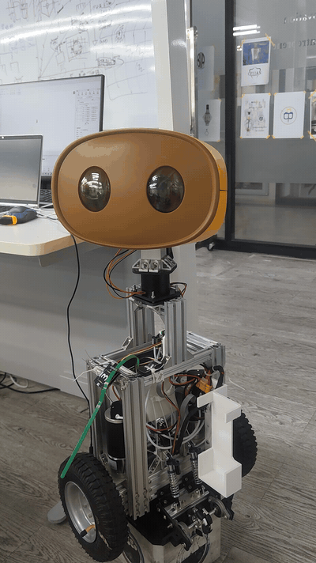
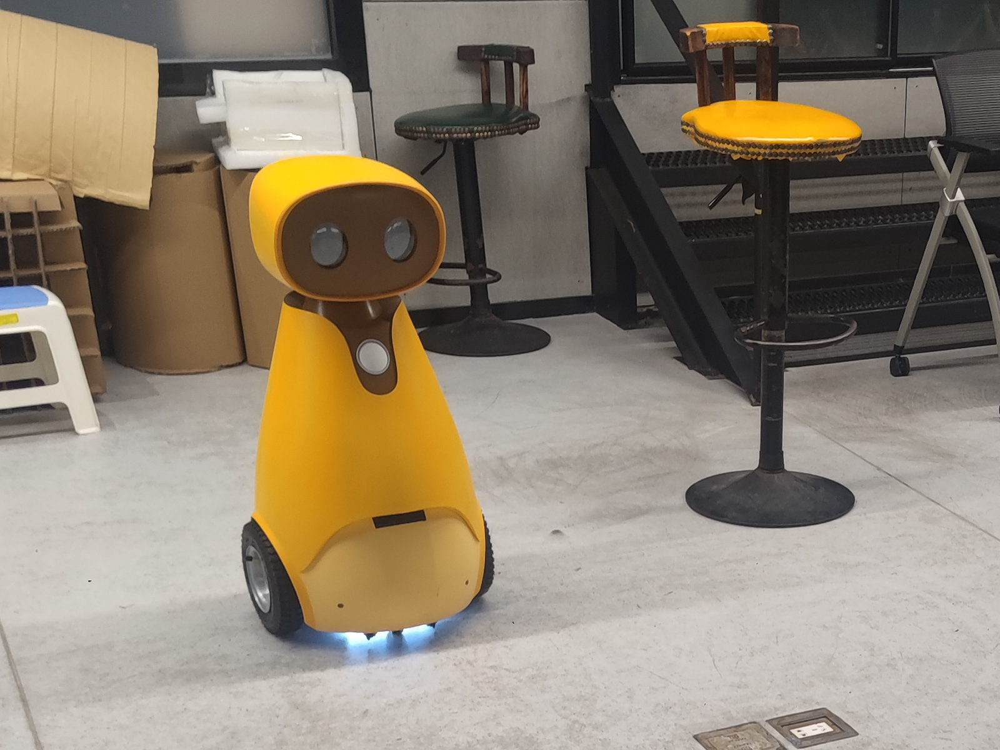

# ROLEy · 乐易

2025 年春天，我们做了 ROLEy：一台用投影和脚踩交互介绍商品的导览机器人原型。

我主要负责机械设计、硬件搭建和控制程序。

## 演示

<table>
  <tr>
    <td width="33%"></td>
    <td width="33%"></td>
    <td width="33%"></td>
  </tr>
</table>

## 实物

  

[过程演示](https://www.canva.cn/design/DAGgrH5c16c/yBGa9gnaUXjy1xfGbXzwEA/view) · [原始资料](doc/showcase.md)

## 机械设计

  

[整机模型](https://cad.onshape.com/documents/4b50ff97ae325c76e82c3ad7/w/b60b42699d5772013056fe9f/e/4009ac390b845918af88e4d9) · [底盘装配](https://cad.onshape.com/documents/4b50ff97ae325c76e82c3ad7/w/b60b42699d5772013056fe9f/e/cc0b1561104cf17267746cdf) · [固件](firmware) · [固件说明](doc/firmware-guide.md)

## 机电连线图

---

> 生出来了，是个宝宝。

感谢队友们的信任，这是这个团队里很宝贵的东西。
