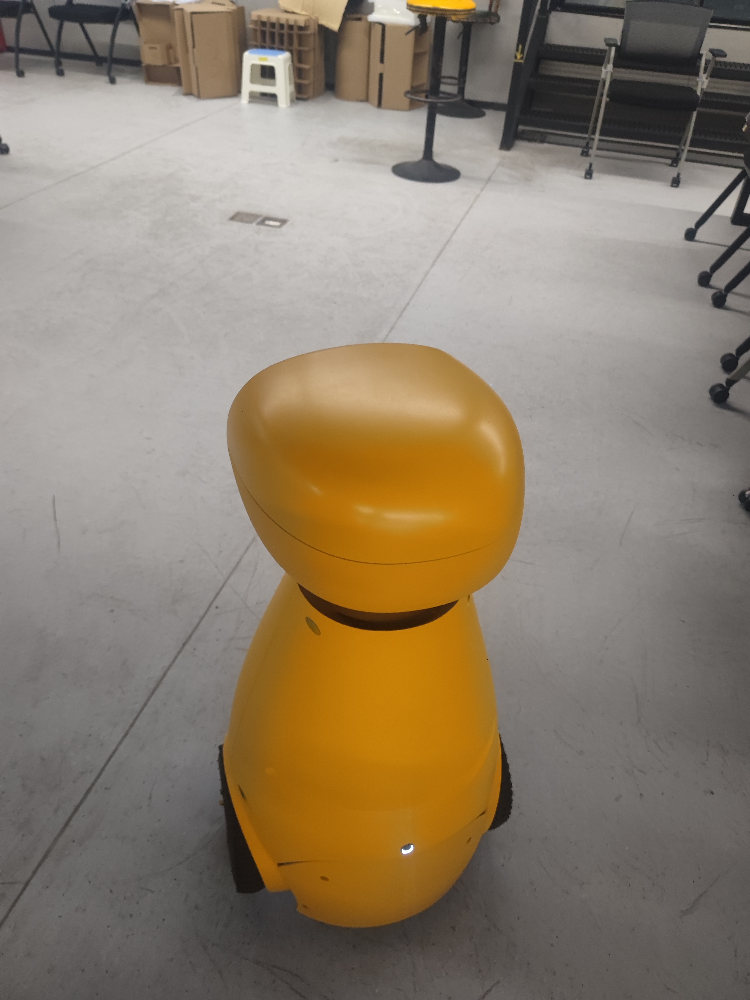
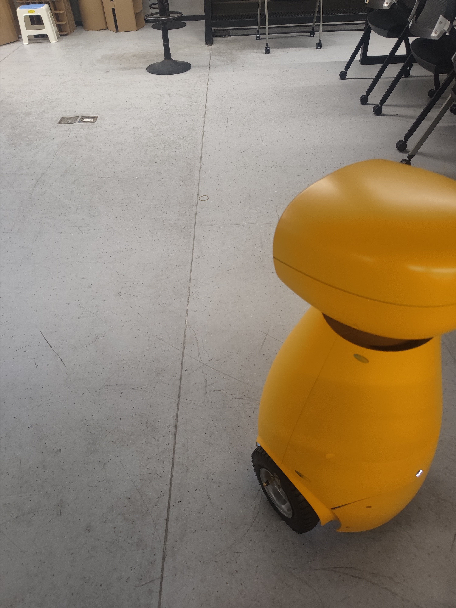
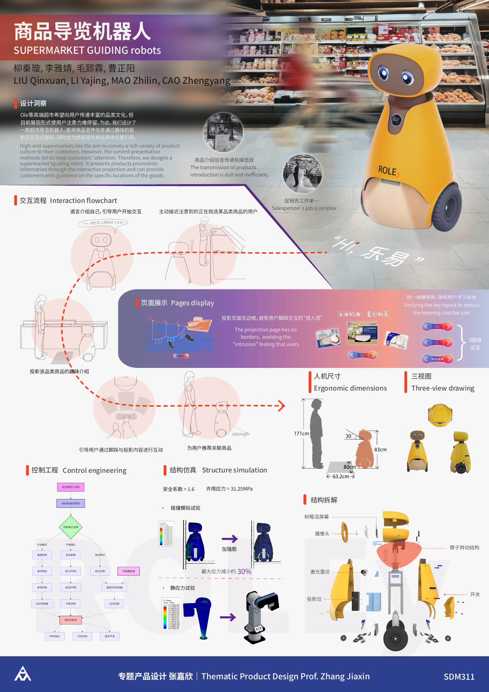
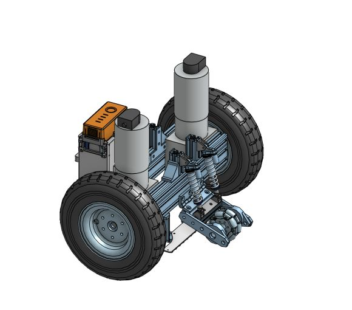
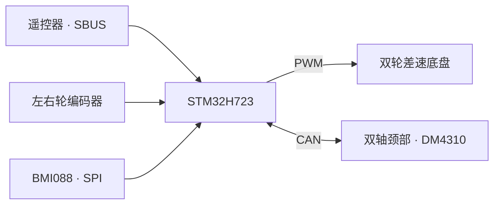

# ROLEy · 商品导览机器人

**机械结构 · 电子硬件 · STM32H7 固件与机电集成**

*A supermarket product-guide robot prototype exploring projection-based interaction.*

ROLEy 是一个 2025 年春季的团队项目，面向超市里的商品介绍与位置引导场景，探索通过趣味投影交互展示商品信息。团队最终完成了可进行功能测试的实物原型。

**我（曹正阳）负责机械结构、电子硬件和软件开发。** 这个仓库目前收录了实物照片、STM32 下位机固件、机电连线图、器件资料与机械设计入口。


项目把遥控输入、轮端反馈和多个执行器接到同一套控制系统里，串起底盘运动与颈部控制。

主控采用 **STM32H723VGT6**。固件包含 **SBUS 遥控、双轮差速底盘、编码器反馈、CAN 双轴颈部和 BMI088 IMU**，并保留了平衡控制实验与循线扩展入口。

[成果资料](doc/showcase.md) · [机械设计索引](doc/mechanical-guide.md) · [固件技术导览](doc/firmware-guide.md) · [完整机电连线图](doc/ROLEy机电连线图_white.drawio.png)

## 实物与装配

<table>
  <tr>
    <td width="50%"></td>
    <td width="50%"></td>
  </tr>
  <tr>
    <td>整机装配：头部、机身外壳与双轮底盘</td>
    <td>侧面视角：机身外壳与底盘布局</td>
  </tr>
</table>

## 项目成果展板

展板集中展示商品导览场景、投影与脚踩交互方案、界面设计、整机尺寸、结构设计与控制工程。

<p align="center">
  <a href="doc/images/roley-project-poster.png"></a>
</p>

图为 2025 年 6 月 3 日项目群分享的 A1 成果展板。打印 PDF、AI 源文件与期末汇报资料的原始位置见[成果资料索引](doc/showcase.md)。

## 机械设计

原始 CAD 设计保留在 Onshape 的「乐易服务机器人」工作区，包含整机、躯体、底盘、电池装配体，以及零件和工程图。

<p align="center">
  
</p>

[打开整机设计工作区](https://cad.onshape.com/documents/4b50ff97ae325c76e82c3ad7/w/b60b42699d5772013056fe9f/e/4009ac390b845918af88e4d9) · [查看底盘装配](https://cad.onshape.com/documents/4b50ff97ae325c76e82c3ad7/w/b60b42699d5772013056fe9f/e/cc0b1561104cf17267746cdf)

当前工作区的资料范围与装配视图状态见[机械设计索引](doc/mechanical-guide.md)。

## 项目里有什么

| 部分 | 内容 | 代码入口 |
| --- | --- | --- |
| 遥控与模式切换 | SBUS 帧解析、摇杆映射、底盘解锁、手动模式选择 | [uart_bsp.c](firmware/User/uart_bsp.c)、[main.c](firmware/Core/Src/main.c) |
| 双轮差速底盘 | 双通道有刷电机 PWM 驱动，前进、后退、转向与限速控制 | [wheeltec_driver.c](firmware/User/wheeltec_driver.c) |
| 轮端反馈 | 双编码器计数、累计角度与速度计算 | [gmr_encoder.c](firmware/User/gmr_encoder.c)、[main.c](firmware/Core/Src/main.c) |
| 双轴颈部 | 两个 DM4310 电机的 CAN 通信、yaw / pitch 控制与软件角度限制 | [roley_neck.c](firmware/User/roley_neck.c)、[dm_motor_ctrl.c](firmware/User/dm_motor_ctrl.c) |
| 姿态感知 | BMI088 的 SPI 初始化、加速度和角速度读取 | [BMI088driver.c](firmware/Device/BMI088/BMI088driver.c) |
| 控制实验 | 平衡控制原型、循线模式入口；当前状态见下文 | [balance_control.c](firmware/User/balance_control.c)、[main.c](firmware/Core/Src/main.c) |

## 系统如何连接



主循环按约 **10 ms** 的间隔处理传感器、遥控与底盘控制；颈部电机通过 TIM2 中断周期更新。底盘控制会检查遥控在线状态和解锁开关。具体通道映射、控制分支与现有边界整理在[固件技术导览](doc/firmware-guide.md)中。

<details>
<summary><strong>展开原始机电连线图</strong></summary>


这是 2025 年 6 月的整机连线设计资料，包含 NUC、屏幕、投影等外围部分；本仓库中的实现主要是 STM32 下位机控制。PNG 内保留了 draw.io 编辑数据，可用 diagrams.net 打开继续编辑。

</details>

## 从哪里开始看

```text
ROLEy/
├── firmware/
│   ├── Core/                 主程序、中断与外设初始化
│   ├── User/                 遥控、底盘、编码器、颈部和控制逻辑
│   ├── Device/BMI088/        IMU 驱动与中间件
│   ├── Drivers/              STM32 HAL 与 CMSIS
│   ├── MDK-ARM/              Keil 工程
│   └── CtrBoard-H7_DBUS.ioc   CubeMX 配置
└── doc/
    ├── images/               实物照片与 CAD 视图
    ├── showcase.md           成果展板、汇报与演示资料索引
    ├── mechanical-guide.md   机械设计工作区与资料索引
    ├── firmware-guide.md     固件导览、遥控映射与工程状态
    ├── *.drawio.png           机电连线设计
    └── 其他资料              传感器手册与厂商示例
```

建议先看 [main.c](firmware/Core/Src/main.c) 的初始化和控制主循环，再沿着 `uart_bsp`、`wheeltec_driver`、`roley_neck` 三个模块阅读输入和执行器的连接方式。

## 工具链与工程状态

- **目标芯片：** STM32H723VGT6。
- **工程入口：** [Keil MDK 工程](firmware/MDK-ARM/CtrBoard-H7_DBUS.uvprojx)；[CubeMX 配置](firmware/CtrBoard-H7_DBUS.ioc)记录的目标工具链为 MDK-ARM V5.32、固件包为 STM32Cube FW_H7 V1.11.2。
- **源码状态：** 当前是历史原型归档。工程引用的 `User/PID/PID.h`、`PID.c` 尚未收录，主程序还保留了未提供实现的 `WheelTec_PIDInit()` 调用，因此尚不能直接完成构建。
- **平衡与循线：** 平衡控制保留实验代码，尚无稳定运行的验证记录；循线分支目前执行停车，尚未接入循线算法。传感器厂商示例放在 `doc/` 下，和本项目固件分开保存。

恢复构建前需要核对的依赖、速度单位和控制接口，见[固件技术导览](doc/firmware-guide.md)。

## 资料与许可

项目团队：柳秦璇、李雅婧、毛郅霖、曹正阳。

连线图、器件手册和厂商示例保留在 `doc/`，用于说明原型的硬件背景。第三方代码与文档保留各自的版权和许可说明；仓库目前未指定统一的项目许可证。
