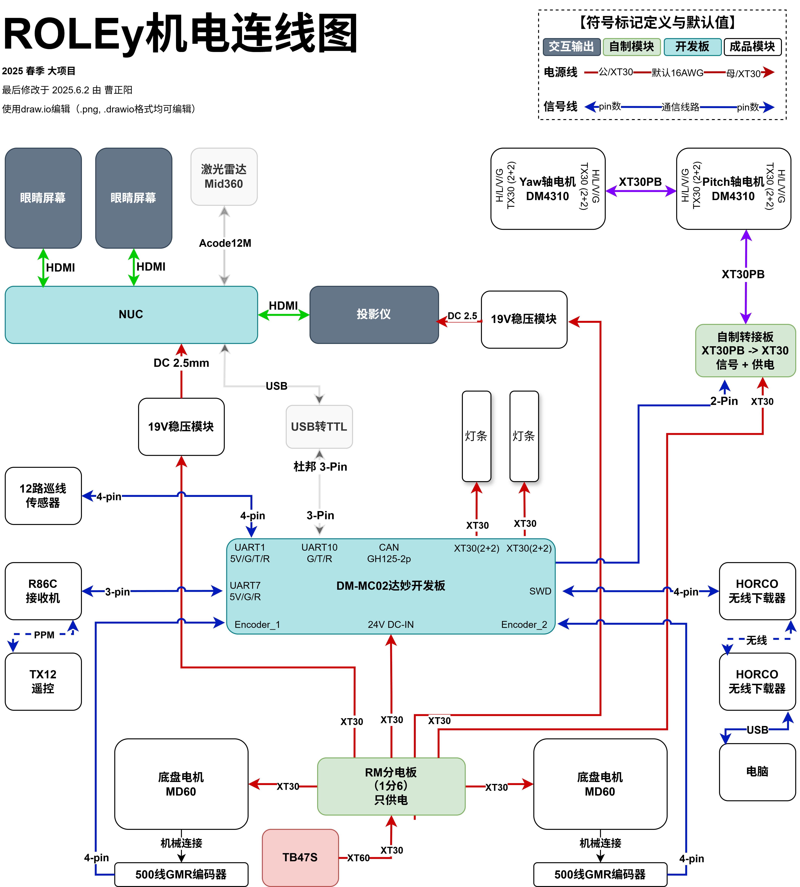

# ROLEy · 乐易

2025 年春天，我们做了 ROLEy：一台用投影和脚踩交互介绍商品的导览机器人原型。

**我（曹正阳）负责全部机械结构、电子硬件和软件实现。**

## 演示

<table>
  <tr>
    <th width="50%">底盘移动测试</th>
    <th width="50%">装好外壳后的演示</th>
  </tr>
  <tr>
    <td></td>
    <td></td>
  </tr>
</table>

## 实物

<table>
  <tr>
    <td width="50%"></td>
    <td width="50%"></td>
  </tr>
</table>

[过程演示](https://www.canva.cn/design/DAGgrH5c16c/yBGa9gnaUXjy1xfGbXzwEA/view) · [原始资料](doc/showcase.md)

## 机械设计

  

[整机模型](https://cad.onshape.com/documents/4b50ff97ae325c76e82c3ad7/w/b60b42699d5772013056fe9f/e/4009ac390b845918af88e4d9) · [底盘装配](https://cad.onshape.com/documents/4b50ff97ae325c76e82c3ad7/w/b60b42699d5772013056fe9f/e/cc0b1561104cf17267746cdf) · [固件](firmware) · [固件说明](doc/firmware-guide.md)

## 机电连线图

---

> 生出来了，是个宝宝。

纪念大学最后一个课程大项目，和一起把它做出来的队友们。

**团队：柳秦璇、李雅婧、毛郅霖、曹正阳。**

南方科技大学 · SDM311 专题产品设计 · 2025 年春季
