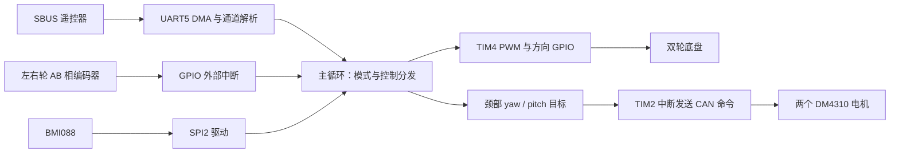

# ROLEy 固件技术导览

这份导览对应仓库保存的 2025 年机器人原型固件，帮助读者理解遥控、底盘、颈部、编码器和 IMU 如何连接。它依据源码与工程配置整理，不代表固件已重新编译、烧录或通过实机验证。下文的构建缺口描述的是当前归档快照，不能据此推断原机器人当时的运行情况。

## 系统与代码入口

控制器为 STM32H723VGT6。主程序使用 STM32 HAL，在裸机循环中处理控制逻辑，另外通过定时器和外设中断接收输入、更新编码器及发送颈部电机命令。

| 模块 | 当前代码承担的工作 | 源码入口 |
| --- | --- | --- |
| 主程序 | 初始化外设、读取传感器、选择模式、分发底盘与颈部命令 | [main.c](../firmware/Core/Src/main.c) |
| SBUS 遥控 | UART5 DMA 接收、解析遥控通道、映射摇杆与开关 | [uart_bsp.c](../firmware/User/uart_bsp.c)、[uart_bsp.h](../firmware/User/uart_bsp.h) |
| 底盘驱动 | 两路有刷直流电机的方向、PWM、逐步改变占空比与停止 | [wheeltec_driver.c](../firmware/User/wheeltec_driver.c) |
| 编码器 | AB 相状态转移计数、累计轮端角度 | [gmr_encoder.c](../firmware/User/gmr_encoder.c)、[中断入口](../firmware/Core/Src/stm32h7xx_it.c) |
| CAN 通信 | FDCAN1 初始化、收发和电机反馈回调 | [bsp_fdcan.c](../firmware/User/bsp_fdcan.c)、[fdcan.c](../firmware/Core/Src/fdcan.c) |
| 达妙电机 | 电机参数、控制帧与反馈解析 | [dm_motor_ctrl.c](../firmware/User/dm_motor_ctrl.c)、[dm_motor_drv.c](../firmware/User/dm_motor_drv.c) |
| 双轴颈部 | yaw／pitch 两个 DM4310 电机的位置命令、软件指令范围检查 | [roley_neck.c](../firmware/User/roley_neck.c)、[roley_neck.h](../firmware/User/roley_neck.h) |
| IMU | BMI088 初始化及 SPI 加速度、角速度、温度读取 | [BMI088driver.c](../firmware/Device/BMI088/BMI088driver.c)、[BMI088Middleware.c](../firmware/Device/BMI088/BMI088Middleware.c) |
| 平衡实验 | 角度和速度 PID 的状态、参数及底盘输出计算 | [balance_control.c](../firmware/User/balance_control.c)、[balance_control.h](../firmware/User/balance_control.h) |
| 外设配置 | 引脚、时钟、DMA、串口、定时器与 SPI 配置 | [CubeMX 工程](../firmware/CtrBoard-H7_DBUS.ioc)、[Core/Src](../firmware/Core/Src) |

## 启动与运行数据流

[main.c](../firmware/Core/Src/main.c) 中的调用顺序为：

1. 初始化 HAL、系统时钟、GPIO、DMA、USART1、UART5、TIM4、FDCAN1、TIM2 和 SPI2。
2. 启动遥控接收，初始化底盘、编码器、CAN、达妙电机和双轴颈部；颈部初始化会写入位置速度模式、保存电机参数并使能电机。
3. 启动 TIM2 中断，初始化平衡控制。此处还调用了当前仓库缺少实现的 `WheelTec_PIDInit()`，详见构建缺口。
4. 获取遥控数据结构指针，循环调用 `BMI088_init()`，返回成功后才进入主循环。
5. 主循环以“距上次更新至少 10 ms”为条件执行一次控制处理。这是代码中的调度目标，没有实测周期与抖动记录。

每次控制处理依次读取 BMI088、从加速度计算俯仰角、读取累计编码器角度并差分计算速度，然后更新底盘模式和颈部目标。底盘只有在遥控数据标记在线、且左肩开关处于 `KEY_DOWN` 时才进入所选控制分支，否则调用 `WheelTec_StopAll()`。

颈部目标更新位于上述底盘条件检查之前；TIM2 中断继续发送颈部命令。因此，源码中的“遥控离线停止”只覆盖底盘分支，不能描述成整机所有电机的失联保护。

## SBUS 通道与遥控模式

串口配置见 [usart.c](../firmware/Core/Src/usart.c)：UART5 为 100000 baud、`UART_WORDLENGTH_9B`、偶校验、2 停止位。软件解析 25 字节 SBUS 帧，校验帧头 `0x0F` 与帧尾 `0x00`，并将第 24 字节等于 `0x0C` 的帧标记为离线。这里描述的是现有解析逻辑，没有额外的接收超时检测。

以下通道编号使用源码中的零起始编号 `ch[0]`～`ch[8]`，与遥控器界面上的编号可能相差一位。

| 通道 | 软件映射 | 用途 |
| --- | --- | --- |
| `ch[0]` | 右摇杆水平 | 颈部 yaw；部分全速差速模式的转向 |
| `ch[1]` | 右摇杆垂直 | 颈部 pitch；双摇杆直控时的电机 2 |
| `ch[2]` | 左摇杆垂直 | 油门；双摇杆直控时的电机 1 |
| `ch[3]` | 左摇杆水平 | 低速差速模式的转向 |
| `ch[4]` | 左肩开关 | `KEY_DOWN` 时允许底盘控制 |
| `ch[5]` | 左侧面开关 | 与右侧面开关组合选择手动子模式 |
| `ch[6]` | 右侧面开关 | 与左侧面开关组合选择手动子模式 |
| `ch[7]` | 右肩开关 | 手动、循线占位、平衡实验三种模式 |
| `ch[8]` | `rssi` | 保存为信号强度字段，未参与主循环的输出控制 |

映射常量见 [uart_bsp.h](../firmware/User/uart_bsp.h)：下端 `224`、中值 `992`、上端 `1759`。`KEY_UP`、`KEY_MID`、`KEY_DOWN` 分别等于这三个数值，开关判断使用精确数值比较；摇杆被线性映射为 `-100`～`100`，油门为 `0`～`100`。

右肩开关决定主模式，实际分支见 `update_control_state()`：

| 右肩开关 | 选择的模式 | 当前分支 |
| --- | --- | --- |
| `KEY_DOWN` | 手动 | 调用 `manual_control()` |
| `KEY_MID` | 循线占位 | 停止底盘，保留 `TODO: line_follow_update()` |
| `KEY_UP` | 平衡实验 | 调用 `balance_update()` |

手动模式中的左右侧面开关组合如下。表格按实际函数调用整理，其中低速与全速模式使用的转向摇杆不同。

| 左侧面开关 | 右侧面开关 | 行为 |
| --- | --- | --- |
| `KEY_MID` | `KEY_MID` | 左、右竖向摇杆分别直接控制电机 1、2，死区为 ±10 |
| `KEY_DOWN` | `KEY_DOWN` | 前进差速，左竖杆油门＋左横杆转向，限速参数 30 |
| `KEY_DOWN` | `KEY_UP` | 倒车差速，左竖杆油门＋左横杆转向，限速参数 30 |
| `KEY_UP` | `KEY_DOWN` | 前进差速，左竖杆油门＋右横杆转向，限速参数 100 |
| `KEY_UP` | `KEY_UP` | 倒车差速，左竖杆油门＋右横杆转向，限速参数 100 |
| 其他组合 |  | 停止底盘 |

颈部在上述各模式下都会更新。因此，双摇杆直控时右竖杆同时影响电机 2 与颈部俯仰，全速差速时右横杆同时影响底盘转向与颈部 yaw。这是现有映射的行为。

## 关键参数的位置

这些是历史原型配置，不能作为其他硬件可直接复用的标定结果。

| 参数 | 当前值或计算方式 | 位置 |
| --- | --- | --- |
| 控制处理间隔 | 至少 10 ms；轮速差分仍使用固定 `0.01f` | [main.c](../firmware/Core/Src/main.c) |
| 颈部命令发送 | TIM2 配置目标 1 ms，回调发送两个电机命令 | [tim.c](../firmware/Core/Src/tim.c)、[main.c](../firmware/Core/Src/main.c) |
| 底盘 PWM | TIM4 通道 3、4；周期计数 `2525` | [tim.c](../firmware/Core/Src/tim.c) |
| PWM 每次变化上限 | `100` 个计数；输入速度按百分比映射 | [wheeltec_driver.c](../firmware/User/wheeltec_driver.c) |
| 编码器参数 | `500` 线、减速比 `18`；实际每圈分母为 `2 × (500 × 18 × 2) = 36000` | [gmr_encoder.h](../firmware/User/gmr_encoder.h)、[gmr_encoder.c](../firmware/User/gmr_encoder.c) |
| 轮直径 | `8 × 0.0254` m，即按 8 英寸计算 | [main.c](../firmware/Core/Src/main.c) |
| 颈部电机标识 | yaw 使用 `motor[Motor1]`，ID `0x01`；pitch 使用 `motor[Motor2]`，ID `0x03` | [roley_neck.h](../firmware/User/roley_neck.h)、[dm_motor_ctrl.c](../firmware/User/dm_motor_ctrl.c) |
| 颈部位置速度模式 | 两轴 `vel_set = 4.0f`，目标位置初始为 `0.0f` | [dm_motor_ctrl.c](../firmware/User/dm_motor_ctrl.c) |
| yaw 指令范围 | −75°～+75° | `update_neck_motor()`，位于 [main.c](../firmware/Core/Src/main.c) |
| pitch 指令范围 | −10°～+20°；源码注明方向与命名仍有对应问题 | 同上 |
| CAN 总线配置 | `.ioc` 计算的标称速率为 1 Mbit/s，外设配置为 Classic CAN | [CubeMX 工程](../firmware/CtrBoard-H7_DBUS.ioc)、[fdcan.c](../firmware/Core/Src/fdcan.c) |
| BMI088 总线配置 | SPI2，8 位，极性高、第二边沿；`.ioc` 计算为 10 Mbit/s | [CubeMX 工程](../firmware/CtrBoard-H7_DBUS.ioc)、[spi.c](../firmware/Core/Src/spi.c) |
| 平衡角度 PID 初值 | `Kp=10`、`Ki=0`、`Kd=0.1`，`T=0.01`、`tau=0.02` | [balance_control.c](../firmware/User/balance_control.c) |
| 平衡速度 PID 初值 | `Kp=Ki=Kd=0` | 同上 |

`neck_rotate_yaw()` 和 `neck_rotate_pitch()` 检查的是输入指令；越界时返回 `false`，保留原有目标，不会把新指令钳制到边界，也没有在这两个函数中根据电机反馈实现机械限位。

## 工具链与当前构建缺口

仓库保存的配置为：

- [CubeMX 工程](../firmware/CtrBoard-H7_DBUS.ioc)：STM32CubeMX `6.10.0`，STM32Cube H7 固件包 `V1.11.2`，器件 `STM32H723VGT6`。
- [Keil 工程](../firmware/MDK-ARM/CtrBoard-H7_DBUS.uvprojx)：目标 `CtrBoard-H7_DBUS`，ARM Compiler `6.22`（ARMCLANG），器件包 `Keil.STM32H7xx_DFP.4.0.0`，CMSIS `6.1.0`。
- `.ioc` 的目标工具链字段写为 `MDK-ARM V5.32`；这与 Keil 工程记录的 ARMCLANG 编译器版本是不同配置字段，应分别核对。

恢复开发时可以从该 `.uvprojx` 查看文件组、包含目录与目标配置，但当前仓库不是可直接复现的完整构建包。逐一解析工程中的 50 个 `<FilePath>`、将反斜杠转换为路径分隔符并相对工程目录检查后，发现以下两个引用文件不存在：

| 工程内引用 | 预期仓库路径 |
| --- | --- |
| `..\User\PID\PID.h` | `firmware/User/PID/PID.h` |
| `..\User\PID\PID.c` | `firmware/User/PID/PID.c` |

`balance_control.h` 与 `balance_control.c` 依赖其中的 `PIDController`、`PIDController_Init()`、`PIDController_Update()`。应恢复原始实现及其来源信息，再核对接口和编译器兼容性。

此外，`main.c` 调用了 `WheelTec_PIDInit()`，但当前仓库源码和头文件中未找到它的定义或声明。这是独立于上述文件缺失的另一个构建缺口。工程引用的其他 48 个文件在本次检查时均存在，包括 RCC、MDMA、HSEM 与 I2C 等 HAL 源文件。

本次只核对源码、工程文件与路径完整性，没有运行 Keil 编译、链接、烧录或硬件测试，也没有通过补写同名函数改变历史固件。

## 实验边界与已知问题

### 循线尚未接入主固件

模式枚举和右肩开关保留了循线入口，但实际分支停止底盘，只有 `TODO`。`doc/` 中保存的灰度传感器示例不能等同于 ROLEy 主程序已实现循线，更不代表已有视觉导航或自主避障。

### 平衡控制仍是实验代码

当前俯仰角来自 `atan2f(accel[2], -accel[1])`。程序读取了陀螺仪数据并保存 `pitch_gyro`，但没有将它送入姿态融合；平衡函数收到的是俯仰角和两轮角速度之和。速度环初始增益全为零，且 PID 依赖未收齐，仓库没有实机稳定平衡的验证记录。

### 轮速与单位需重新核对

[gmr_encoder.c](../firmware/User/gmr_encoder.c) 当前使用累计计数换算角度，取余的旧公式已注释。因此 `gmr_encoder_get_position()` 不会每转一圈自动回到 0°；头文件仍写的“0～360”是过时注释。`gmr_encoder_get_speed()` 只返回结构体字段，当前更新代码没有维护该速度字段；主程序实际使用的是角度差分。

主程序按固定 `0.01` 秒计算角速度，没有使用实际经过时间。后续命名为 `encoder*_speed_mps` 的变量又把 `rad/s` 乘以轮周长，量纲换算多了 `2π` 因子。正确的几何关系为 `v = ω × r`（ω 用 rad/s）或 `v = n × πd`（n 用 rev/s）。因此这些历史变量不能直接作为已校准的 m/s 测量结果。
