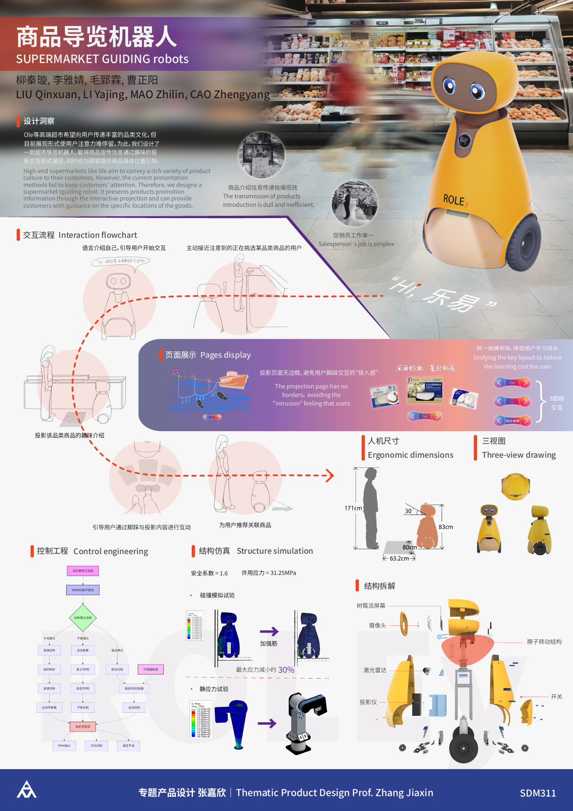

# ROLEy 成果资料

ROLEy 商品导览机器人项目的展板、演示与原始设计文件索引。

## 2025-06-03 成果展板

展板为 A1 竖版单页，标题为 **「商品导览机器人 / SUPERMARKET GUIDING robots」**，包括设计洞察、投影交互流程、页面展示、人机尺寸、三视图、控制工程、结构仿真与结构拆解。

[查看完整展板预览](images/roley-project-poster.png)

打印用 PDF 与 Illustrator 原文件保存在飞书 **「ROLEy-乐易」群 → 文件** 中，可搜索 `Group3_ROLEy`：

| 文件 | 群文件显示大小 | 分享者 | 分享时间 |
| --- | --- | --- | --- |
| `Group3_ROLEy.pdf` | 89.4 MB | 柳秦璇 | 2025-06-03 20:35 |
| `Group3_ROLEy.ai` | 90.2 MB | 柳秦璇 | 2025-06-03 20:35 |

展板按分享日期标识版本；上述记录是群文件中这两个文件名下的最新分享记录，不据此额外标注为最终定稿。仓库提供 PNG 阅读预览，打印与继续编辑使用群内原文件。

## 项目演示资料

| 资料 | 入口 | 版本记录 |
| --- | --- | --- |
| 项目演示 PDF | 群文件中搜索 `Final Pre_Group3_ROLEy的诞生日记.pdf` | 柳秦璇，2025-06-08 18:39；29.7 MB |
| 项目过程演示资料「小乐易の企业行」 | [Canva 查看稿](https://www.canva.cn/design/DAGgrH5c16c/yBGa9gnaUXjy1xfGbXzwEA/view) | 2025-06-04 群内分享 |

Canva 链接按群消息标题归入过程演示资料，未作为最终演示稿的版本依据。在线文稿与群文件沿用各自现有的访问权限。

## 相关工程资料

- [实物照片与项目首页](../README.md)
- [机械设计索引](mechanical-guide.md)
- [固件技术导览](firmware-guide.md)
- [机电连线图](ROLEy机电连线图_white.drawio.png)
